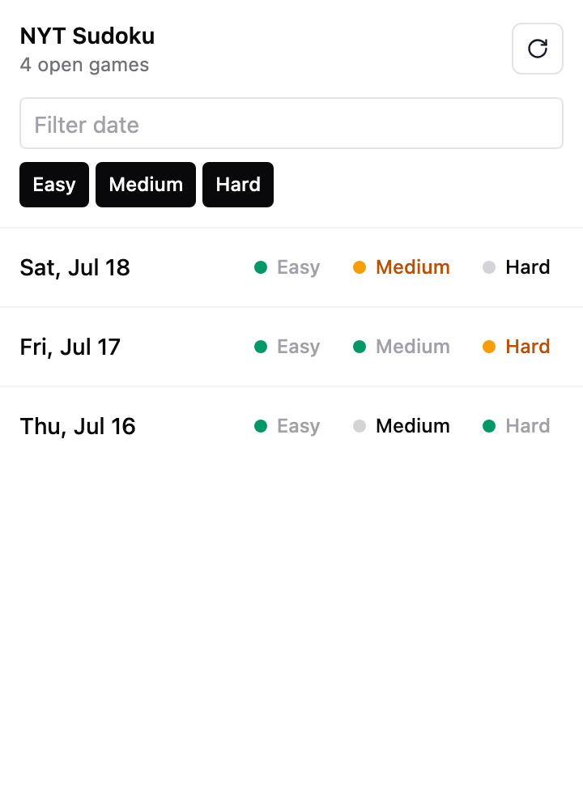

# NYT Sudoku Progress

A small, read-only Chrome extension for finding unfinished NYT Sudoku games
played through SudokuPad.

<p align="center">
  
</p>

## Features

- Shows the last 90 days of Easy, Medium, and Hard puzzles
- Distinguishes completed, started, and untouched games
- Hides days where every puzzle is complete
- Filters the list by date and difficulty
- Opens any puzzle directly in SudokuPad
- Refreshes progress without reloading the extension
- Keeps all progress data in the browser

## Privacy

The extension does not collect, store, or transmit personal data.

It runs only on `sudokupad.app`, where a content script reads the local storage
entries SudokuPad uses for NYT puzzle progress. The popup requests a snapshot
from an open SudokuPad tab and renders it locally. There are no analytics,
external API calls, accounts, or backend services.

## Install from source

Requirements:

- Chrome or another Chromium browser with Manifest V3 support
- [Bun](https://bun.sh/)

Build the extension:

```sh
bun install
bun run build
```

Then load it in Chrome:

1. Open `chrome://extensions`.
2. Enable **Developer mode**.
3. Select **Load unpacked**.
4. Choose the generated `dist` directory.
5. Open a puzzle on [SudokuPad](https://sudokupad.app/), then open the
   extension popup.

Rebuild and reload the unpacked extension after making source changes.

## Development

```sh
bun run dev
```

The Vite development server is useful for iterating on the popup UI. Browser
extension APIs are available only when the built extension is loaded in a
Chromium browser.

Create a production build with:

```sh
bun run build
```

## How it works

```text
SudokuPad local storage
        │
        ▼
Manifest V3 content script
        │ read-only snapshot
        ▼
Extension popup
        │
        └── links back to individual SudokuPad puzzles
```

The content script recognizes SudokuPad's stored NYT puzzle identifiers and
completion markers. The popup normalizes those values into daily progress and
fills in missing puzzles for a rolling 90-day window.

## Project structure

```text
public/manifest.json    Chrome extension manifest
src/content.ts          Reads SudokuPad progress from local storage
src/chrome.ts           Popup-to-tab messaging adapter
src/storage-parser.ts   Normalizes progress and completion records
src/App.tsx             Popup interface
```

## Disclaimer

This is an independent project and is not affiliated with The New York Times
or SudokuPad.

## License

[MIT](LICENSE)
